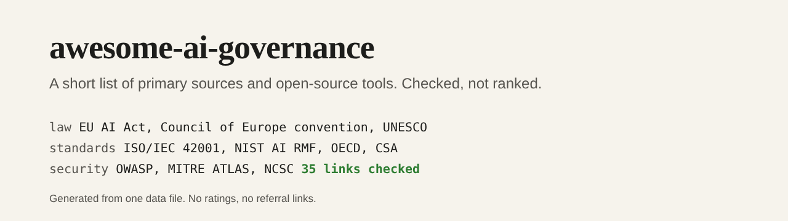

# awesome-ai-governance

  

A short, checked list of primary sources and open-source tools for AI governance: the law, the standards, the guidance from public bodies, the security references, the incident databases and the tools for testing and fairness.

It is small on purpose. Every entry is a primary source or a tool I could open and read, with a one-sentence description that says what it is, not how good it is. If you want a long list, other lists exist; if you want somewhere to start that you can trust, start here.

## Contents

- [Regulation and law](#regulation-and-law)
- [Standards and frameworks](#standards-and-frameworks)
- [Guidance from public bodies](#guidance-from-public-bodies)
- [Security and threat models](#security-and-threat-models)
- [Risk catalogues and incident databases](#risk-catalogues-and-incident-databases)
- [Testing, evaluation and red teaming tools](#testing-evaluation-and-red-teaming-tools)
- [Fairness tools](#fairness-tools)
- [Documentation practice](#documentation-practice)
- [By the maintainer](#by-the-maintainer)
- [How this list is kept honest](#how-this-list-is-kept-honest)
- [Contributing](#contributing)
- [Licence](#licence)

## Regulation and law

Primary legal texts and the bodies that implement them.

- [AI Act Explorer](https://artificialintelligenceact.eu/ai-act-explorer/): A browsable version of the Act by article, recital and annex, from the Future of Life Institute.
- [Council of Europe Framework Convention on AI](https://www.coe.int/en/web/artificial-intelligence/the-framework-convention-on-artificial-intelligence): The first legally binding international treaty on AI, human rights, democracy and the rule of law.
- [EU AI Act, official text](https://eur-lex.europa.eu/eli/reg/2024/1689/oj): The authoritative text of Regulation (EU) 2024/1689 in the Official Journal.
- [European Commission AI Office](https://digital-strategy.ec.europa.eu/en/policies/ai-office): The Commission body that supports AI Act implementation, with guidance and codes of practice.
- [UNESCO Recommendation on the Ethics of AI](https://www.unesco.org/en/artificial-intelligence/recommendation-ethics): A global ethical standard adopted by UNESCO member states, with policy action areas.

## Standards and frameworks

Frameworks and standards you can build a management system on.

- [CSA AI Controls Matrix](https://cloudsecurityalliance.org/artifacts/ai-controls-matrix): A vendor-neutral control framework for trustworthy AI from the Cloud Security Alliance.
- [ISO/IEC 42001](https://www.iso.org/standard/81230.html): The international standard for an AI management system, with a free summary page and a paid full text.
- [NIST AI Risk Management Framework](https://www.nist.gov/itl/ai-risk-management-framework): A voluntary framework to govern, map, measure and manage AI risk.
- [NIST AI RMF Generative AI Profile](https://www.nist.gov/publications/artificial-intelligence-risk-management-framework-generative-artificial-intelligence): A companion profile that applies the AI RMF to generative AI risks.
- [OECD AI Principles](https://oecd.ai/en/ai-principles): Intergovernmental principles for trustworthy AI, the basis of much national policy.
- [Singapore's approach to AI governance](https://www.pdpc.gov.sg/organisations/resources/guidance-by-topic/singapores-approach-to-ai-governance): Singapore's guidance on AI governance, including its Model AI Governance Framework.

## Guidance from public bodies

Practical guidance from regulators and government bodies.

- [ICO guidance on AI and data protection](https://ico.org.uk/for-organisations/uk-gdpr-guidance-and-resources/artificial-intelligence/): The UK regulator's guidance on applying data protection law to AI systems.
- [NCSC guidelines for secure AI system development](https://www.ncsc.gov.uk/collection/guidelines-secure-ai-system-development): Secure design, development, deployment and operation guidance from the UK NCSC and partners.
- [OECD.AI Policy Observatory](https://oecd.ai/): A directory of national AI policies, tools and metrics.
- [UK AI Security Institute](https://www.aisi.gov.uk/): The UK government body that evaluates advanced AI and publishes research.

## Security and threat models

Where AI security is described and catalogued.

- [Google Secure AI Framework](https://saif.google/): A conceptual framework for securing AI systems, with a risk self-assessment.
- [MITRE ATLAS](https://atlas.mitre.org/): A knowledge base of adversary tactics and techniques against AI systems.
- [OWASP GenAI Security Project](https://genai.owasp.org/): OWASP's home for generative AI security guidance, checklists and resources.
- [OWASP Top 10 for LLM Applications](https://genai.owasp.org/llm-top-10/): The ten most critical security risks for applications built on large language models.

## Risk catalogues and incident databases

Evidence of what goes wrong, and structured ways to think about it.

- [AI Incident Database](https://incidentdatabase.ai/): A searchable collection of reports of harms and near harms caused by AI systems.
- [MIT AI Risk Repository](https://airisk.mit.edu/): A database of AI risks from the literature, with a taxonomy.
- [OECD AI Incidents Monitor](https://oecd.ai/en/incidents): A monitor of AI incidents and hazards drawn from news sources.

## Testing, evaluation and red teaming tools

Open-source tools for testing and evaluating AI systems.

- [garak](https://github.com/NVIDIA/garak): A vulnerability scanner for large language models.
- [Giskard](https://github.com/Giskard-AI/giskard-oss): An open-source evaluation and testing library for LLM agents.
- [Inspect](https://github.com/UKGovernmentBEIS/inspect_ai): A framework for large language model evaluations from the UK AI Security Institute.
- [promptfoo](https://github.com/promptfoo/promptfoo): A command-line tool and library for evaluating and red-teaming LLM applications.
- [PyRIT](https://github.com/microsoft/PyRIT): A framework for finding risks in generative AI systems, from Microsoft.

## Fairness tools

Open-source tools for measuring and reducing bias.

- [AI Fairness 360](https://github.com/Trusted-AI/AIF360): A toolkit of fairness metrics and bias mitigation algorithms.
- [Fairlearn](https://github.com/fairlearn/fairlearn): A Python package to assess and improve the fairness of machine learning models.

## Documentation practice

How to describe a model so others can judge it.

- [Hugging Face model cards](https://huggingface.co/docs/hub/model-cards): A practical guide to documenting a model, with a template.
- [Model Cards for Model Reporting](https://arxiv.org/abs/1810.03993): The 2018 paper that proposed model cards as short documents for reporting a model.

## By the maintainer

Related repositories by the maintainer. Listed last and kept short on purpose.

- [ai-governance-toolkit](https://github.com/pJijesh/ai-governance-toolkit): A control matrix mapping ISO/IEC 42001, the EU AI Act and NIST AI RMF, with templates and a validator.
- [ai-use-register-skill](https://github.com/pJijesh/ai-use-register-skill): An agent skill that finds AI use in code and builds an evidence-cited AI system register.
- [eu-ai-act-risk-classifier](https://github.com/pJijesh/eu-ai-act-risk-classifier): A short questionnaire that gives an EU AI Act risk tier, obligations and key dates.
- [eu-ai-act-tracker](https://github.com/pJijesh/eu-ai-act-tracker): A sourced EU AI Act timeline as data, with a calendar file and a small CLI.

## How this list is kept honest

- **Source of truth is [`data/resources.json`](data/resources.json).** This README is generated from it with `node scripts/build.mjs`, and a test fails if the two disagree.
- **Rules are checked by tests**: https links only, no duplicates, every category known, one-sentence descriptions that end with a full stop, no promotional wording, no long dashes.
- **Links are checked by a script**, `node scripts/check-links.mjs`, which a scheduled workflow runs monthly. Some sites (for example ISO) refuse automated requests; the script reports those as blocked, not broken, and they need checking by hand.
- **No ratings, no rankings and no affiliate links.** Entries are in alphabetical order within a section.
- **Laws and standards change.** An entry is a place to start, not legal advice. Check the date and version of whatever you rely on.

## Contributing

Suggestions are welcome. Read [CONTRIBUTING.md](CONTRIBUTING.md) first: add one entry to `data/resources.json`, run `node scripts/build.mjs` and `node --test`, and open a pull request. A good entry is a primary source or an open-source tool that is maintained, with a description that is neutral and checkable.

## Licence

[MIT](LICENSE), 2026 Puliyappottammal Jijesh. The linked resources belong to their owners and have their own licences.

Maintained by [Puliyappottammal Jijesh](https://www.linkedin.com/in/pjijesh), an IT manager. [GitHub](https://github.com/pJijesh)
